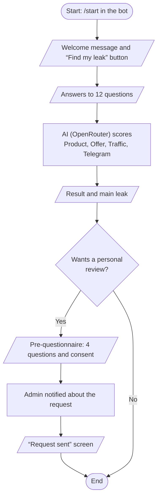

# Lead Magnit Bot

A Telegram bot with a mini app that runs an AI diagnostic of an expert's lead generation system. The user answers 12
questions, AI scores four areas (Product, Offer, Traffic, Telegram) and points out the main lead leak. After that the
user can request a personal review from Darya. The admin gets notifications and sees all users in the admin panel.

## How it works



## Structure

- `backend/` — FastAPI + aiogram in one process: API for the mini app, the bot (long polling), PostgreSQL via
  SQLAlchemy, Alembic migrations.
- `frontend/` — React + Vite mini app; in production it is served by nginx, which proxies the API to the backend.

## Running

Environment variables are described in [`backend/.env_example`](backend/.env_example):

```bash
cp backend/.env_example backend/.env
```

### Docker

```bash
docker compose up -d --build
```

- Starts PostgreSQL, the backend (migrations are applied on startup) and the frontend on `127.0.0.1:8020`.
- The frontend needs an HTTPS proxy (nginx, Caddy) with your domain in front of it — that address goes into `WEBAPP_URL`.
- Admin panel — send `/admin` to the bot from the `ADMIN_TG_ID` account.

### Local

Requires Python 3.13, Node.js 22 and PostgreSQL; use `localhost` as the host in `DATABASE_URL`.

```bash
cd backend
python -m venv .venv
.venv/Scripts/activate
pip install -r requirements.txt
alembic upgrade head
python main.py
```

```bash
cd frontend
npm install
npm run dev
```

The mini app opens at `http://localhost:5173` and proxies the API to `127.0.0.1:8000`. Inside Telegram it only works
over HTTPS, so to test it in the bot you need a tunnel (e.g. ngrok) with its address in `WEBAPP_URL`.
